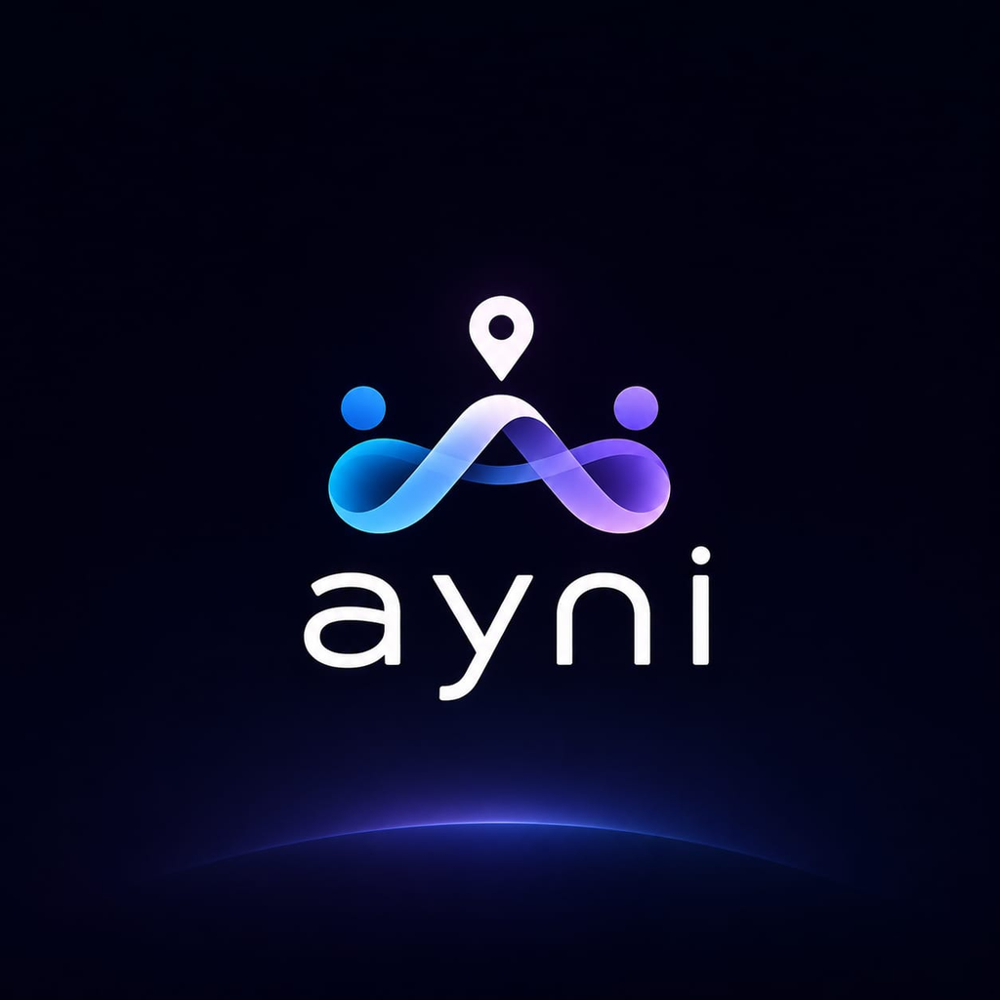

# Ayni

*A little from everyone.*

**Find the fairest place for everyone to meet.** Create a room, share one invite link, and Ayni finds real meeting spots that balance everyone's travel time — then the group votes, the host locks it in, and everyone navigates to the same place.

🌐 **Live app: [https://meetsync-roan.vercel.app](https://meetsync-roan.vercel.app)** — open it on your phone, create a room, and share the link. No install, no sign-up form: you just pick a name and a starting point.

> **India-first, open-source only.** Built for complicated Indian roads and galis: real road routing (not straight lines), scooter as a first-class travel mode, and city presets for Bengaluru, Delhi, Mumbai, Pune, Hyderabad, and Chennai. Maps, places, and routing use only open data and open services — MapLibre + OpenStreetMap + Photon + OSRM. No Google Maps, no Google API keys, no Google billing, no paid mapping API. See [MAPS.md](MAPS.md).

## How it works

1. **Create** a meeting room — give it a title, your name, and your starting location (GPS, a saved area preset, a search, or drop a pin on the map).
2. **Share** the invite link (`/join/<code>`). Friends join from any browser or device — no accounts, no passwords.
3. **Search** for meeting points. The optimization engine finds real nearby places (cafés, restaurants, malls, metro stations, markets, tea stalls, parks, and more), routes everyone to each one on real roads, and ranks the top 5 by the strategy you pick: **Balanced** (fair mix of average and longest trip), **Fairest** (shortest longest trip — nobody gets sacrificed), or **Fastest overall** (lowest total travel time).
4. **Publish** the live results to the vote ("Add these places to the vote"). Everyone in the room sees the same ranked list instantly and can rank them.
5. **Vote** — each person saves one ranking; saving again replaces it. The group winner is computed from everyone's rankings (first-choice + Borda tally).
6. **Finalize** — the host locks in the group winner (or any spot). Every page in every browser shows the same "Meeting point locked in" announcement.
7. **Navigate** — per-person travel times, ETAs, animated routes, and directions links. Arrival is optional and reversible ("I've arrived" / clear it).

Everything updates **live**: joins, locations, votes, and the final decision arrive without reloading, via Supabase Realtime.

## Features

- **Group rooms** with secure invite codes, anonymous sign-in, and live presence (who's joined, who's ready).
- **Fair meeting-point engine** — real OSRM road times for every person × every candidate; no straight-line times in the live path; per-person explanations naming the longest trip; honest warnings (single participant, static road times with no traffic model, pre-filter notes). The Routes map follows the search: the #1 result is previewed on the map automatically, and tapping any result re-points the map at it. See [ENGINE.md](ENGINE.md).
- **Live places, votable** — search results from Photon (OpenStreetMap data) can be published as votable spots. Published spots are shared with the whole room in ranked order, a new publish supersedes the old batch, and re-publishing never duplicates. Live spots are badged "Live place" and never show invented ratings, prices, or open-now status — if the data doesn't have it, the app doesn't show it.
- **Voting + host-only finalization** — one active ranking per person, replace-on-save, group-winner tally, version-guarded finalize (a stale finalize can't overwrite a decision), finalized announcement on all room pages.
- **Privacy by design** — directions links appear only on your own row (built from your own location); other rows show ETA/duration only; shared links are spot-only with no starting point. Locations expire after 2 hours and old rooms are pruned by a scheduled cleanup function. Coordinates are never put in shared URLs.
- **Maps in 3D** — MapLibre vector map with 3D building extrusion, tilt controls, fly-to, auto-fit, animated route playback with progress/speed controls, and an immersive-3D mode with a 2D fallback. Raster OSM tiles if the vector style fails.
- **Travel modes** — Walk, **Scooter** (two-wheeler — "Bike" means scooter here), Car, Transit. Scooter routes on the closest available road profile and is labelled honestly.
- **India-first details** — city presets (Bengaluru areas + Delhi, Mumbai, Pune, Hyderabad, Chennai), categories for malls, metro/railway stations, markets, and tea stalls, and live testing on real Indian road networks.
- **Resilient live sync** — bounded reconnect with backoff, offline/reconnecting states, stale-result guards when the room changes mid-search, and a manual retry that always works.
- **Demo mode** — with no configuration at all, the app runs a fully labelled demo (4 friends, 3 Bengaluru spots, sample room code `K7M2QX`) so anyone can click through the whole flow.

## Tech stack

- **Frontend:** React 18 + TypeScript (strict) + Vite 5, Tailwind CSS v3, React Router v6, Framer Motion
- **Backend:** Supabase — PostgreSQL + Row Level Security, anonymous auth, Realtime, Edge Functions (Deno)
- **Maps & geo:** MapLibre GL JS + OpenFreeMap Liberty vector tiles (OpenStreetMap data), Turf.js, OSRM routing (opt-in, development), Photon place search (OpenStreetMap data, default live provider), Overpass API + a Supabase proxy function as alternatives for self-hosters
- **Tests:** Vitest (unit + integration + RLS)

One codebase, one `RoomService` interface: when Supabase env vars are present the app uses Supabase + Edge Functions + Realtime; otherwise it runs in clearly-labelled **Demo mode** with local mock data. Maps are additive sections inside the existing screens; the layout is kept stable for later updates.

## Routes

| Route | Page |
|---|---|
| `/` | Landing |
| `/create` | Create Meeting |
| `/join` | Join Meeting |
| `/join/:code` | Join Meeting (code pre-filled) |
| `/room/:code/lobby` | Meeting Lobby |
| `/room/:code/routes` | Route Discovery (search + publish) |
| `/room/:code/compare` | Spot Comparison (vote) |
| `/room/:code/navigate` | Final Navigation |

The invite code is always in the URL, so meeting links work across browsers and devices. Unknown rooms show an error state with a link to `/join`.

## Launch it

### Option A — Just use the live app (no setup)

Open **[https://meetsync-roan.vercel.app](https://meetsync-roan.vercel.app)** → **Create a meeting** → share the invite link with your group. That's it.

### Option B — Run it locally in Demo mode (no Supabase needed)

```bash
npm install
npm run dev
```

Open the printed URL (default `http://localhost:5173`). The header shows **"Demo mode — Supabase not configured"**. Try the sample room: Join → code `K7M2QX`, or open `/join/K7M2QX`.

Demo flow: Landing → Create → Lobby → Routes → Compare (rank + save vote) → Finalize → Navigate. Maps need network access to load tiles; without network the map shows an error panel with a text list of locations. Route lines use demo estimates by default (zero network calls).

### Option C — Run it locally with your own Supabase project (full live mode)

See **[SUPABASE.md](SUPABASE.md)** for the full guide: create a project, enable Anonymous auth, apply the migrations, deploy the Edge Functions, set secrets, and enable Realtime. In short:

```bash
cp .env.example .env
# Fill in VITE_SUPABASE_URL and VITE_SUPABASE_ANON_KEY (public anon key only)
npm install
npm run dev
```

The header then shows **"Live · Supabase"**. The service-role key is **never** used in browser code — it is an Edge Function secret only.

To get live road routing + live place search locally, also set:

```bash
VITE_ROUTING_PROVIDER=osrm
VITE_PLACES_PROVIDER=photon
```

Live search needs **both** a live places provider and `VITE_ROUTING_PROVIDER=osrm`; mixed configs fall back to the labelled demo path. See [ENGINE.md](ENGINE.md) and [MAPS.md](MAPS.md) for the demo-server fair-use limits before relying on the public OSRM/Photon instances.

### Environment variables

Only two are required, both public and safe to bake into the frontend bundle:

| Variable | Required? | What it is |
|---|---|---|
| `VITE_SUPABASE_URL` | For live mode | Your Supabase project URL |
| `VITE_SUPABASE_ANON_KEY` | For live mode | Your Supabase **anon/public** key (never the service-role key) |

Everything else is optional and documented in [`.env.example`](.env.example): map style/raster fallback, routing provider + OSRM endpoint/timeouts, places provider (mock / photon / overpass / proxy) + endpoints, and engine limits (max candidates, max OSRM requests, places per area). If the Supabase vars are absent, the app runs in Demo mode.

## Deploy it

**Frontend (Vercel):** this repo is connected to Vercel — every push to `main` auto-deploys to production ([https://meetsync-roan.vercel.app](https://meetsync-roan.vercel.app)). `vercel.json` holds the SPA rewrite (`/(.*)` → `/index.html`) so deep links like `/join/<code>` work. Set `VITE_SUPABASE_URL`, `VITE_SUPABASE_ANON_KEY`, `VITE_ROUTING_PROVIDER=osrm`, and `VITE_PLACES_PROVIDER=photon` as Production + Preview env vars (the anon key is deliberately stored as exposed config — it is the publishable key).

**Backend (Supabase):** apply the 9 migrations in order (Dashboard → SQL Editor — see [SUPABASE.md](SUPABASE.md) §3), deploy the Edge Functions (`supabase functions deploy --use-api`), and set the `CLEANUP_SECRET` + `CLEANUP_RETENTION_DAYS` secrets. Optionally schedule `cleanup-expired-locations` every 15 minutes (SUPABASE.md §10).

## Project structure

```
src/
  types/        Shared TypeScript types
  data/         Mock data: exactly 4 friends + 3 Bengaluru spots
  lib/          utils, validation, distance (haversine + estimates),
                supabaseClient, useRoomDetail hook
  map/          MapLibre config, styles, OSRM routing client, Turf
                helpers, geolocation hook, per-screen route fetching
  engine/       Optimization engine: pure core (validation, search
                areas, scoring, ranking, places, animation) +
                Photon/Overpass/proxy places clients + OSRM strict
                routing + orchestrator + config + publish helpers
  coordination/ Group coordination: pure state machine, voting/tally,
                ETA, expiry, navigation privacy, arrival, stale guard,
                reconnect helper, typed errors (see COORDINATION.md)
  services/     RoomService interface + mock + supabase implementations
                + service selection (getRoomService)
  components/   Layout, Navbar, SpotCard, ParticipantAvatar,
                LoadingSkeleton, ErrorBanner, LocationPicker,
                OptimizationPanel, RoomBanners,
                map/MeetingMap + map/RouteLegend +
                map/RouteAnimationControls + map/useRouteAnimation
  pages/        7 pages (see Routes above)
supabase/
  migrations/   0001 schema, 0002 RLS, 0003 Realtime + expiry,
                0004 no-seed, 0005 coordination (decision version,
                arrival, expire_rooms), 0006 audit hardening
                (RPC lockdown, vote validity, atomic replace_votes),
                0007 scooter mode, 0008 live spots (osm_id),
                0009 published rank (shared published order)
  functions/    create-room, join-room, update-location,
                finalize-meeting, publish-results, places-search,
                cleanup-expired-locations + _shared/
tests/
  unit/         Validation, invite-code, haversine + route-estimate,
                map, engine (scoring, validation, search areas,
                places, animation, ranking, config, strict routing,
                publish), coordination (state machine, voting, ETA,
                expiry, stale guard, navigation privacy, arrival,
                reconnect, errors)
  integration/  Optimization runs against mocked Photon/Overpass/OSRM
                responses; coordination flows against two mock
                services sharing a store
  rls/          Unauthorized-access tests (skipped without test env vars)
docs/           Optional manual seed snippet (never auto-applied)
```

## Scripts

| Command | What it does |
|---|---|
| `npm run dev` | Vite dev server |
| `npm run build` | `tsc --noEmit` + production build |
| `npm run preview` | Serve the production build locally |
| `npm test` | Unit tests (no Supabase needed, no network) |
| `npm run test:maps` | Map-layer unit tests only (config, routing, Turf, styles, geolocation) |
| `npm run test:integration` | Coordination + optimization integration tests against mocked services/responses (no network) |
| `npm run test:rls` | RLS unauthorized-access tests (needs test env vars; skips gracefully without them — see TESTING.md) |
| `npm run test:all` | All tests |

## Testing

- **Unit tests:** `npm test` — 396 tests covering invite-code format, validation, haversine distance, route estimates, map config, OSRM parsing/throttle/cache, Turf bounds/centre, style fallback, geolocation messages, engine scoring/validation/search-areas/places/animation/ranking/config, strict OSRM mode, publish helpers, search-result preview mapping, immersive-3D capability, and the coordination state machine/voting/ETA/expiry/stale guard/navigation privacy/arrival/reconnect/errors. Must pass with no env vars and no network.
- **Integration tests:** `npm run test:integration` — 31 tests: full optimization runs against mocked places/OSRM responses (happy path, exclusions, 429/failure handling, dedup, quota, batching, demo path) and coordination flows against two mock services sharing one store (voting replacement, host/non-host finalization, same-destination reads, stale versions, arrival, expiry, stale optimization, mocked-channel reconnect). Must pass with no network.
- **Live two-browser verification:** see **[TESTING.md](TESTING.md)**. The app has been verified end-to-end in two independent real browsers against the deployed site + real Supabase project: room creation/join via invite link, realtime join/ready/vote/finalize without reloads, Photon live search (1- + 2-person, all strategies), publish → vote → finalize of real places, shared published ranking for guests, supersede on re-publish, own-row-only navigation privacy, arrival, and the stale-result guard (rooms 3VJ6K7, KQQCXR, WC7E75, 69S8W8 — all recorded in TESTING.md). Still unverified: concurrent finalize, expiry display, forced-offline reconnect, animation progressive reveal, immersive-3D rendering, and mobile touch — all listed honestly in TESTING.md.

## Documentation

| Doc | Covers |
|---|---|
| [SUPABASE.md](SUPABASE.md) | Backend setup: project, auth, migrations, RLS, Edge Functions, secrets, Realtime, cleanup schedule |
| [MAPS.md](MAPS.md) | Map providers, styles, 3D, GPS/pin picking, OSRM routing + fair-use limits, production guidance |
| [ENGINE.md](ENGINE.md) | Optimization engine: validation, search areas, scoring math, ranking, places providers (Photon/Overpass/proxy), OSRM strict mode, publish flow, animation |
| [COORDINATION.md](COORDINATION.md) | Voting/tally, state machine, finalization + version guard, ETA/navigation privacy, arrival, expiry, stale guard, reconnect, shared published order |
| [TESTING.md](TESTING.md) | Manual checklists (§4–§8), live verification records, and everything still unverified |

## Design notes

- **Dark navy** (`#070B1A`) with blue + violet gradients, glass cards, Framer Motion page transitions, mobile-first layouts with safe-area padding.
- **Validation everywhere:** title 3–60 chars, display name 2–30 chars, invite-code format, location required. Inline errors + loading skeletons + error banners with retry.
- **Locations expire after 2 hours** (DB trigger + cleanup Edge Function / pg_cron — see SUPABASE.md).
- **Demo vs Supabase storage:** Demo mode persists rooms in `localStorage` (single-browser demo only). Supabase mode stores no room state in `localStorage` except a display-name draft and last-code hint; room state lives in PostgreSQL and syncs via Realtime.
- **Maps:** one `MeetingMap` component (MapLibre + OpenStreetMap), additive map sections in Lobby / Routes / Navigate, GPS + pin picking in `LocationPicker`. Routing is a separate client-side layer (`useMapRoutes` + OSRM client), not a `RoomService` method. Mock/demo data is labelled in the UI; see [MAPS.md](MAPS.md).
- **Optimization engine:** pure-TypeScript core + places/OSRM clients in `src/engine/`; ranking uses road times only (no straight-line fallback in the live path). See [ENGINE.md](ENGINE.md). Animated route playback (`useRouteAnimation` + `RouteAnimationControls`) is independent of routing and consumes geometries only.
- **Group coordination:** pure coordination layer in `src/coordination/` (state machine, voting/tally, ETA, expiry, navigation privacy, arrival, stale guard, reconnect, typed errors); host-only version-guarded finalization; Realtime on four tables with 300 ms coalescing and bounded reconnect backoff. Navigation links are OpenStreetMap + `geo:` (open-source only, no Google). See [COORDINATION.md](COORDINATION.md).
- **Publish flow:** live search results become votable spots through the `publish-results` Edge Function (JWT + membership + state guards, idempotent upsert by OSM id, shared `published_rank` so every participant sees the same ranked order). See [ENGINE.md](ENGINE.md) + [COORDINATION.md](COORDINATION.md).

## Deviations from the original brief

None material. Two clarifications, both documented where they occur:

1. **Spot seeding REMOVED in v0.7.3:** `create-room` used to seed the same three Bengaluru spots server-side (RLS forbids direct browser inserts into `candidate_spots`). That seeding is gone: new live rooms start with zero spots, and spots arrive only when someone publishes live search results via `publish-results`. Demo mode still uses the three sample spots (explicitly labelled sample data). Existing rooms keep the spots they already have.
2. **Route estimates in Supabase mode** are computed client-side with the same deterministic formula as Demo mode. The `route_estimates` table exists (with RLS) for future server-computed estimates. Live road routing via OSRM is a separate client-side layer (`useMapRoutes`); it does not write to `route_estimates`.

## Version history

- **v0.8.1** — Brand logo: the wave-and-pin mark in the navbar, a favicon and touch icon for the browser tab, and the full logo at the top of this README.
- **v0.8.0** — Rebrand: MeetSync 3D is now **Ayni** ("A little from everyone"). User-visible name, title, footer, landing header, and docs updated; internal identifiers, storage keys, and deployment URLs unchanged.
- **v0.7.4** — Error-boundary safety net: a page that crashes while rendering shows a plain-words fallback with Reload / Back to home instead of a blank screen; the app shell survives and navigating to another route resets it.
- **v0.7.3** — New live rooms start empty (no more seeded Bengaluru demo spots); the map reframes on participants + the selected spot when the selection changes, while "Fit all" still frames everything.
- **v0.7.2** — The Routes map follows the search: the #1 result is auto-previewed and tapping any result previews it on the map.
- **v0.7.1** — Shared published ranking: every participant sees published results in the same ranked order; re-publish supersedes the previous batch.
- **v0.7.0** — Live search results can be published as votable spots and finalized.
- **v0.6.3** — Photon place search (works from networks where Overpass is blocked).
- **v0.6.0** — Audit fixes (18 majors), scooter mode, India city presets + categories.
- **v0.5.0** — Group coordination: voting, host-only finalization, ETA/navigation, arrival, expiry, reconnect.
- **v0.4.0** — Optimization engine: fair ranking on real road times.
- **v0.3.0** — Open-source maps: MapLibre + OpenStreetMap + OSRM.
- **v0.2.0** — UI + Supabase integration (rooms, Realtime, Edge Functions).

## License

MIT — see [LICENSE](LICENSE).
